<p align="center">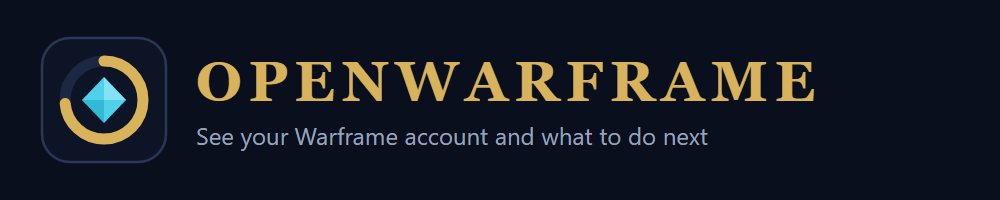</p>

# OpenWarframe

OpenWarframe is a free Windows app for Warframe players. It reads your account and shows what
you own, what you are missing, and where to get it. You can keep it open next to the game.

The screenshots below show a real account (MR 24, PC).

## What it does

- Reads your public profile: mastery rank, the XP on every item you have leveled, and star chart
  progress.
- Reads your inventory from the running game, if you allow it: relics, blueprints, resources,
  Foundry, mods, credits and platinum.
- Matches both against the game's item lists, recipes and drop tables.
- Checks the current fissures, void storms, invasions and Baro Ki'Teer against what you own.
- Shows all of it in one window, with tables you can sort, filter and export.

## What you can use it for

- Finding the frames and weapons you still need to level for your next mastery rank.
- Seeing which of your relics hold parts you need, and which open fissures they fit.
- Finding the missions that drop the parts you are missing.
- Picking a reward on the relic reward screen.
- Seeing what your spare parts, relics and mods are worth in ducats or platinum.
- Getting a short list of things to do when you have 15, 30, 60 or 90 minutes.
- Exporting your account to Excel, PDF, Word, CSV, JSON or SQLite.

## Download

1. Go to the [latest release](https://github.com/AES256Afro/OpenWarframe/releases/latest) and
   download `OpenWarframe-<version>-windows.zip`.
2. Unzip it and run `OpenWarframe.exe`. The app is not code-signed, so Windows SmartScreen asks
   once: click **More info**, then **Run anyway**.
3. On first start the app downloads the game's item and drop data (about a minute). Then either
   click **Find my account in the game** with Warframe running, or type your account ID. The
   welcome screen explains how to find it.

Or install with one line in PowerShell. This also adds a desktop icon, and running it again
updates the app:

```powershell
irm https://raw.githubusercontent.com/AES256Afro/OpenWarframe/main/packaging/install.ps1 | iex
```

The app needs Chrome or Edge for its window. [docs/INSTALL.md](docs/INSTALL.md) covers checking
the download, antivirus warnings and uninstalling.


## Features

### Focus

Shows one task at a time: what to do, where, why, and about how long it takes. **Not now** skips
it. **I'm tired** puts quick tasks first. It also has a session planner, daily and weekly
checklists that reset with the game, goals with progress bars, and settings for larger text,
higher contrast and no animation. Only relics you own are suggested unless you turn that off.

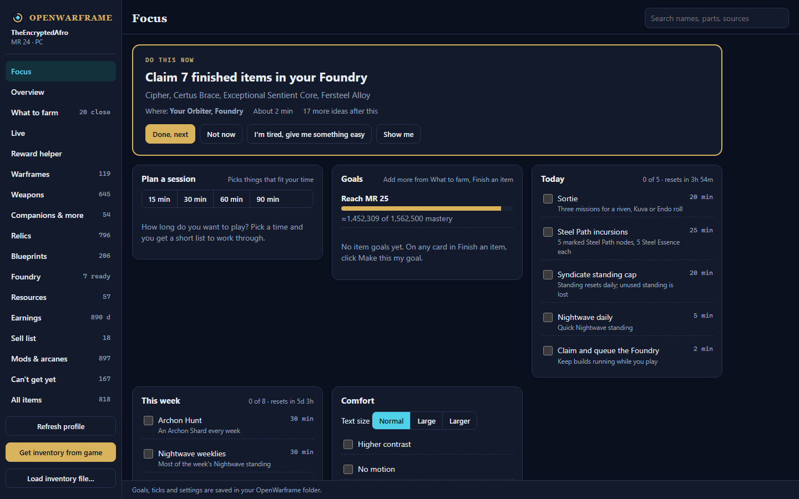

### Overview

Mastery rank and progress, how much of each category you have mastered, items you own but have
not finished leveling, Foundry status, spare Prime parts and your wallet.

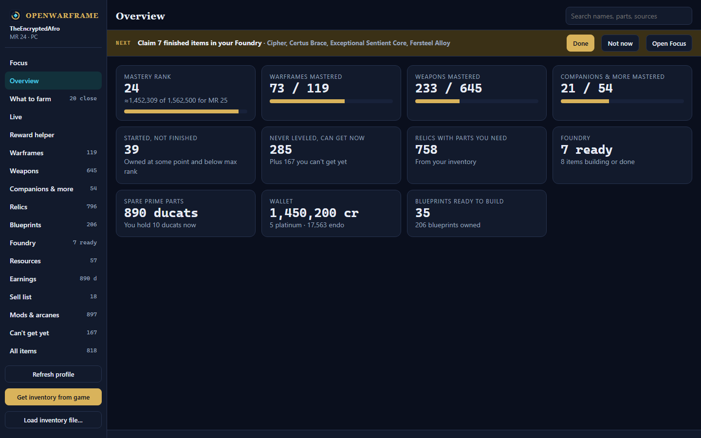

### What to farm

- **Missions to run:** every mission ranked by how many things you need it drops, with the best
  rotation. Missions the community commonly uses for relic farming are marked.
- **Finish an item:** each item you have not mastered, the pieces you are missing, the relics you
  own that hold them, the build cost, and the market price if you would rather buy.
- **Relics to crack:** the relics you own that hold the most parts you need.


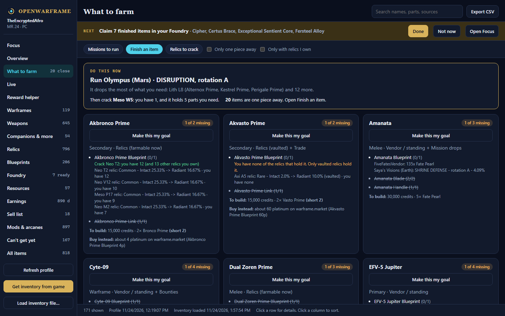

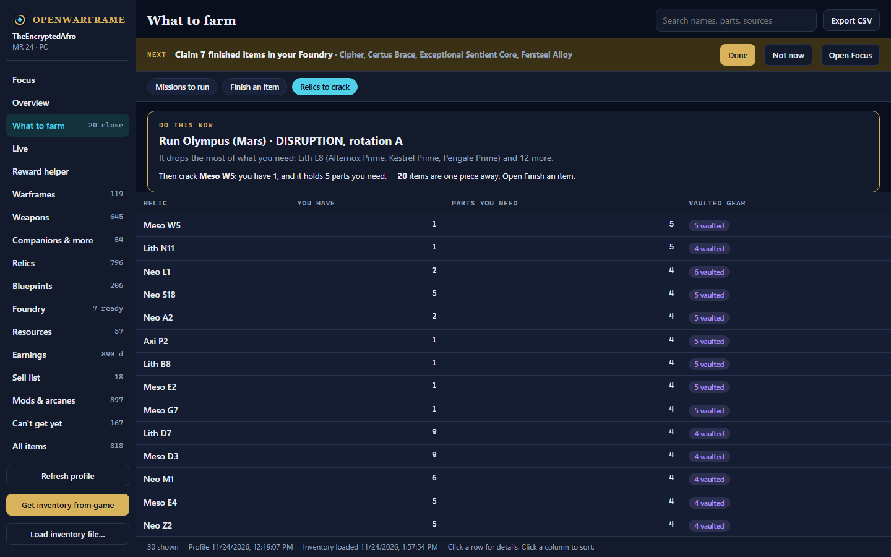

### Live

Current fissures, void storms, invasions and Baro Ki'Teer, matched to your relics and needs. It
also shows which mission you are in, read from the game's log file.


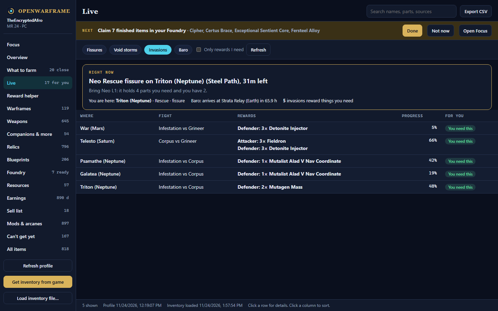

### Reward helper

When the relic reward screen opens, the app reads the reward names from your screen with
Windows' built-in text recognition. It then ranks them: parts you need first, then vaulted parts,
then market price, then ducats. A small window can stay on top of the game to show the pick.


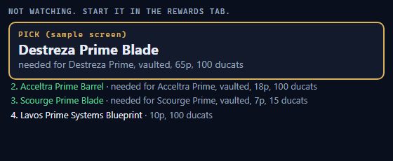

### Warframes, weapons and companions

Every masterable item with its status: mastered, leveling, never leveled, owned or not owned. It
also shows the mastery rank required, how to get the item, and whether you can get it now.


### Relics

Every relic, with how many you own at each refinement, the parts you still need, how many of its
rewards are vaulted, and market prices.


### Blueprints, Foundry and resources

- **Blueprints:** what you own, what is ready to build, and what each build costs.
- **Foundry:** what is ready to claim and what is still building.
- **Resources:** how much you have, how much your blueprints need, and where to farm the rest.

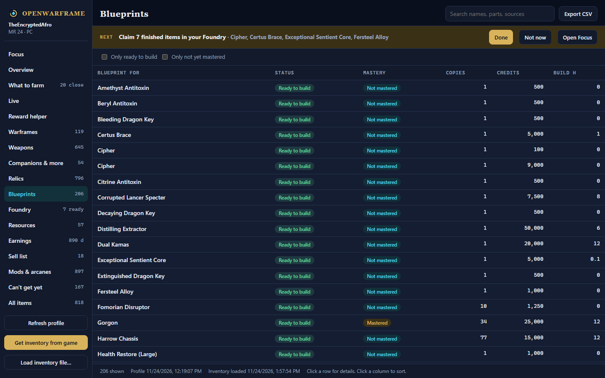

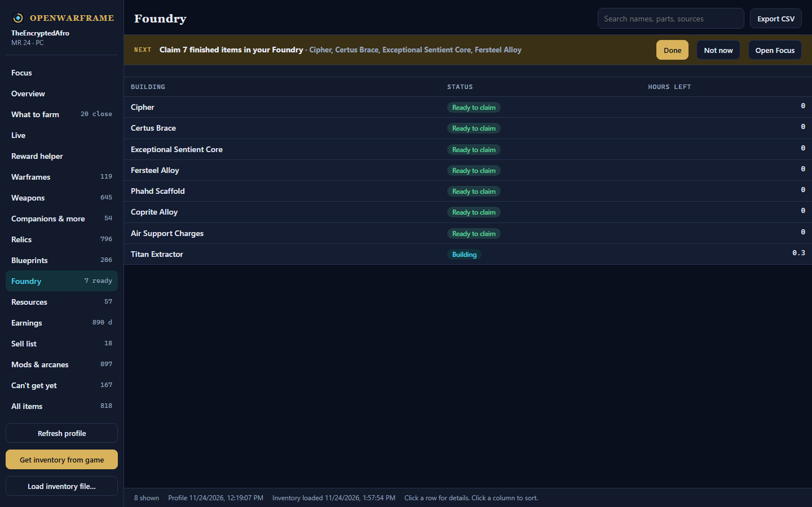

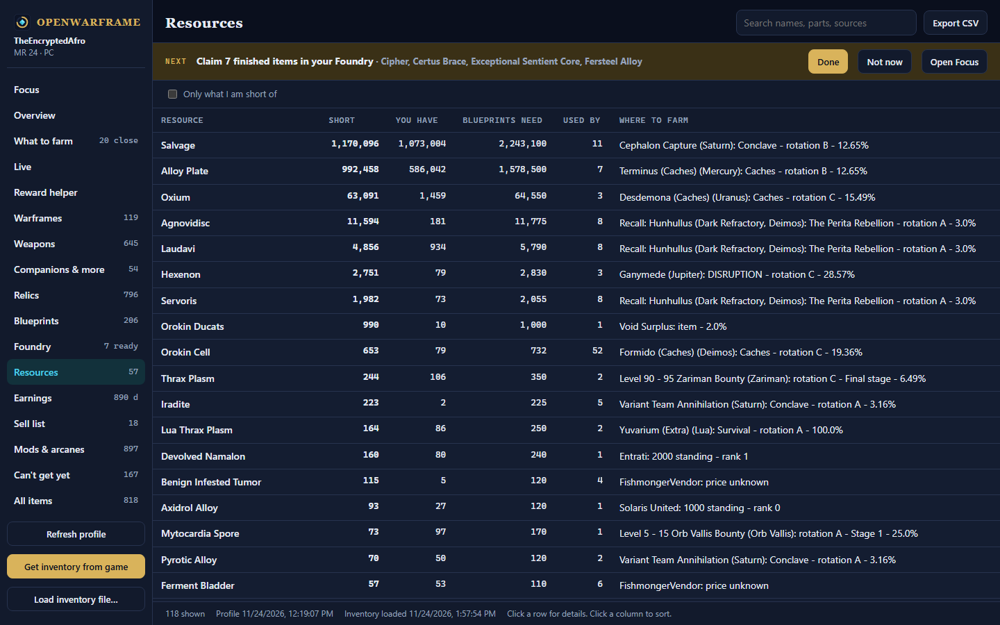

### Earnings and sell list

What your spare Prime parts are worth in ducats, and what your spares, relics and mods sell for
on warframe.market. The sell list keeps one of any part you still need for a build.

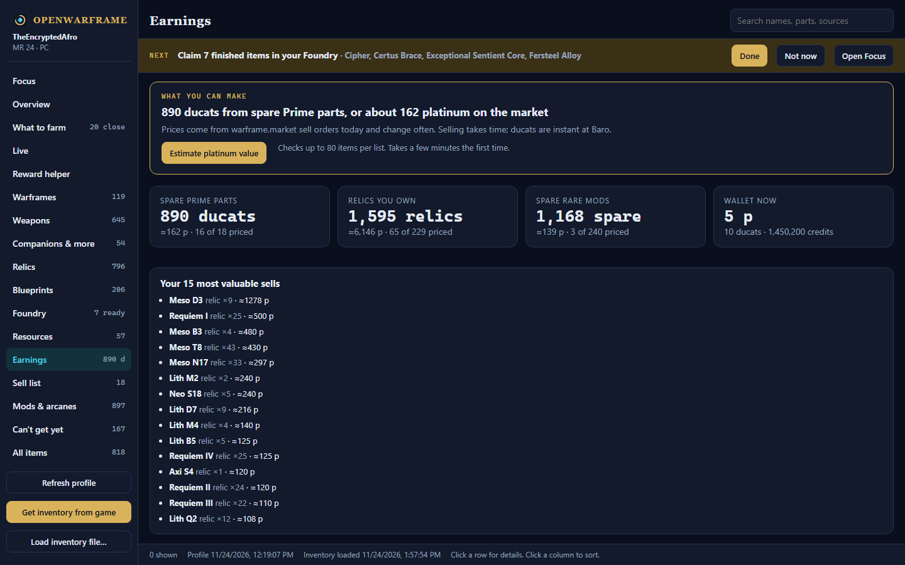

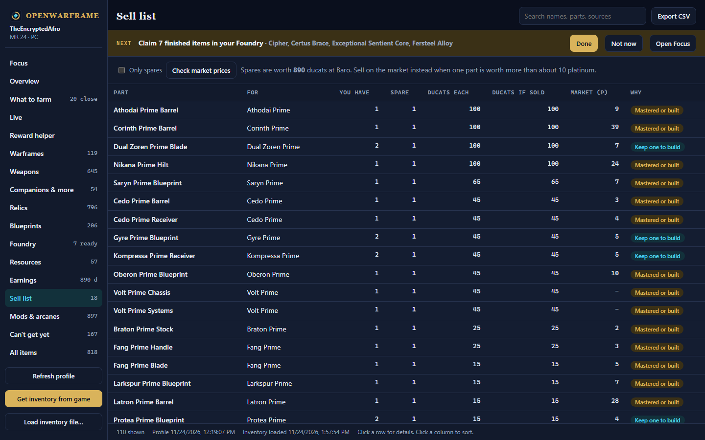

### Mods and arcanes

Every mod and arcane you own, with counts, spares, best rank and market price.

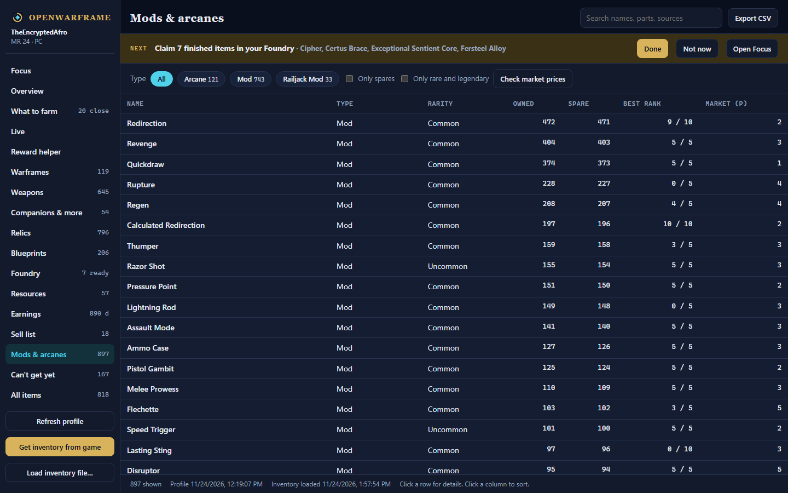

### Can't get yet

Items you cannot get right now, and why: mastery rank, syndicate standing, vaulted, or event only.

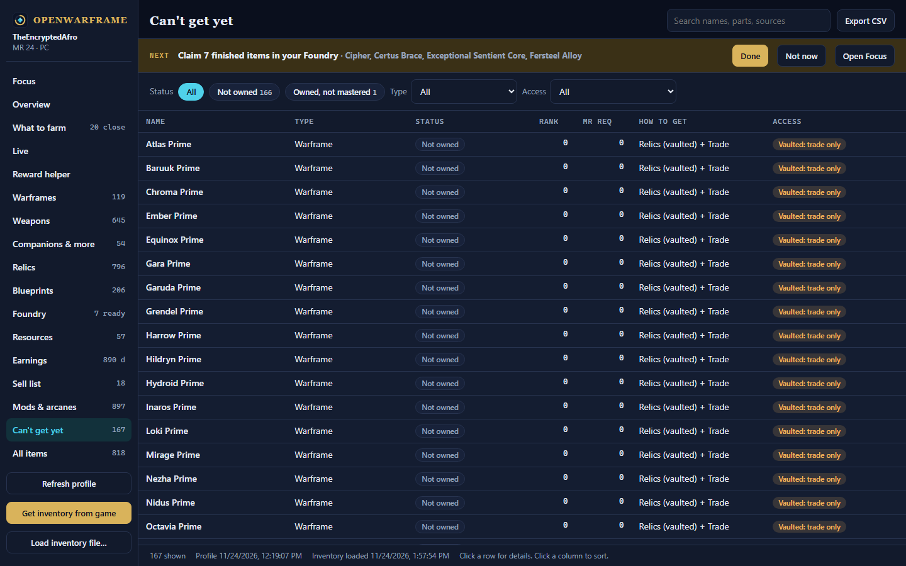

### Exports

From the command line, `openwarframe export` writes your account as JSON, SQLite, CSV, an Excel
workbook, an account dashboard (HTML, PDF and Word), and a summary sized for ChatGPT, Claude or
another AI model. `openwarframe guide mastery` writes a step-by-step plan to mastery rank 30 that
covers every remaining rank test.

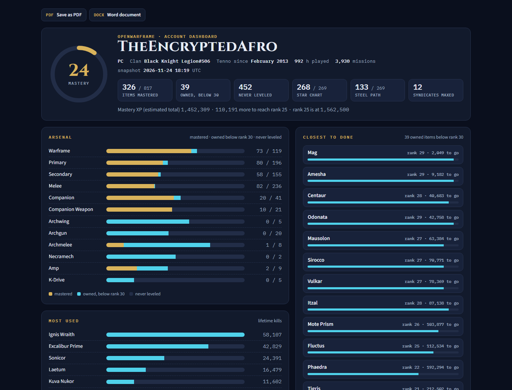

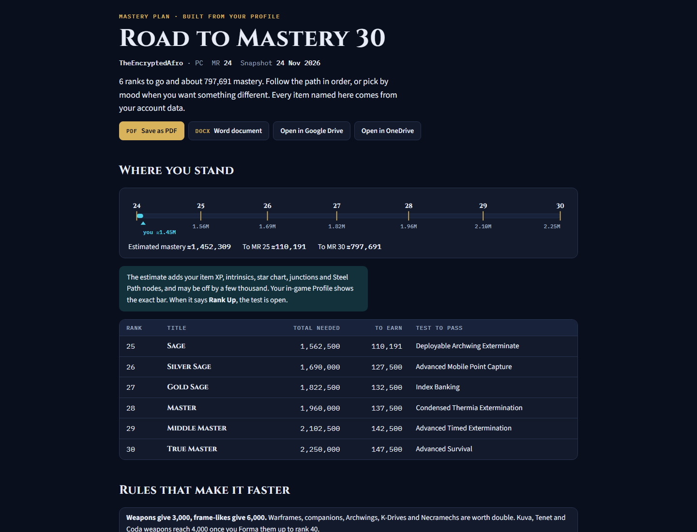

More screenshots are in [docs/screenshots](docs/screenshots).

## Where the data comes from

- **Your public profile:** the same page the in-game profile viewer uses. It only needs your
  account ID.
- **Your inventory:** not public. With your permission, **Get inventory from game** finds your
  login session in the running game's memory (read-only), downloads your inventory from Digital
  Extremes with it, and then forgets it. You can also load an inventory file instead.
- **Game data:** Digital Extremes' official item lists and drop tables, plus community data from
  [warframe-public-export-plus](https://github.com/calamity-inc/warframe-public-export-plus) and
  [WFCD warframe-drop-data](https://github.com/WFCD/warframe-drop-data).
- **Live events:** Digital Extremes' official world state feed.
- **Prices:** [warframe.market](https://warframe.market), only when you ask for them.

Your data is saved in `%LOCALAPPDATA%\OpenWarframe` on your PC. Details:
[docs/DATA_SOURCES.md](docs/DATA_SOURCES.md).

## Privacy and risk

- The app sends requests to Digital Extremes, GitHub, drops.warframestat.us and warframe.market.
  Nothing about you is sent anywhere else. There is no account to create and no tracking.
- Reading the game's memory only happens when you click **Get inventory from game**, and the app
  asks before the first time. Digital Extremes' terms mention programs that read the game's
  memory, and their policy is that third-party tools are used at your own risk. Everything else
  in the app works without it.
- The reward helper only reads the game's log file and takes screenshots of the game window. It
  never touches game memory or sends key presses. The screens it reads are saved in your data
  folder, so you can check its accuracy. You can delete them.
- The app never asks for your password and never changes anything in the game.

More detail: [docs/ACCOUNT_DATA_ACCESS.md](docs/ACCOUNT_DATA_ACCESS.md).

## Command line

The app covers everyday use. The zip also has `openwarframe-cli.exe` (installed as `openwarframe`
by the PowerShell line) for exports:

| Command | What it does |
| --- | --- |
| `gui` | Open the app (`--shortcut` adds a desktop icon) |
| `sync` | Download your public profile |
| `inventory grab` | Download your inventory from the running game |
| `inventory import <file>` | Load an inventory file |
| `export` | Write your account to JSON, SQLite, CSV, Excel, HTML, PDF and Word |
| `guide mastery` | Write your plan to mastery rank 30 (`--pdf`, `--docx`) |
| `codex sources "<item>"` | Where to get an item |

Run `openwarframe --help` for the full list.

## Building from source

You need [uv](https://docs.astral.sh/uv/).

```bash
uv sync --all-groups
```

```bash
uv run openwarframe gui
```

```bash
uv run pytest -q
```

Release zips are built by [.github/workflows/release.yml](.github/workflows/release.yml) when a
version tag is pushed. The icon and logo come from [docs/brand/icon.svg](docs/brand/icon.svg); run
`uv run python packaging/render_brand.py` after changing it.

## Credits and license

MIT licensed; see [CONTRIBUTING.md](CONTRIBUTING.md). Game data keeps its own license and is
credited in [docs/DATA_SOURCES.md](docs/DATA_SOURCES.md). OpenWarframe is a fan project. It is not
made by or affiliated with Digital Extremes.
