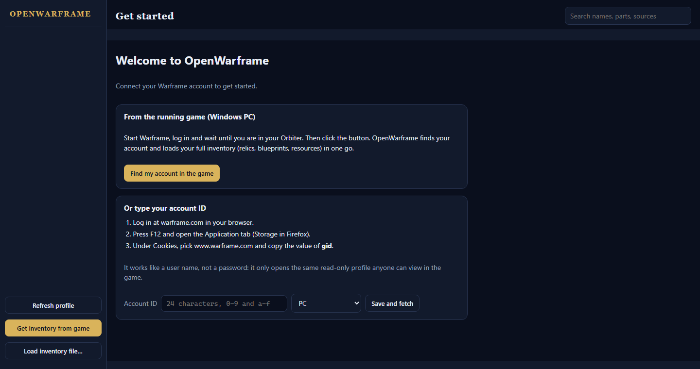
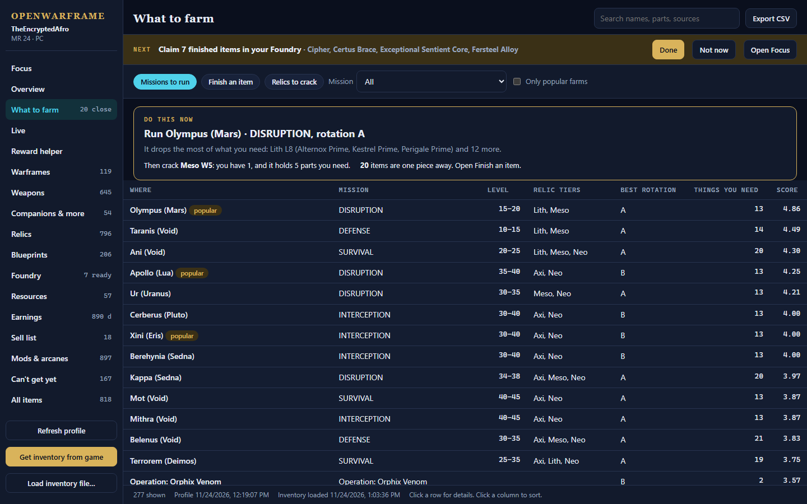
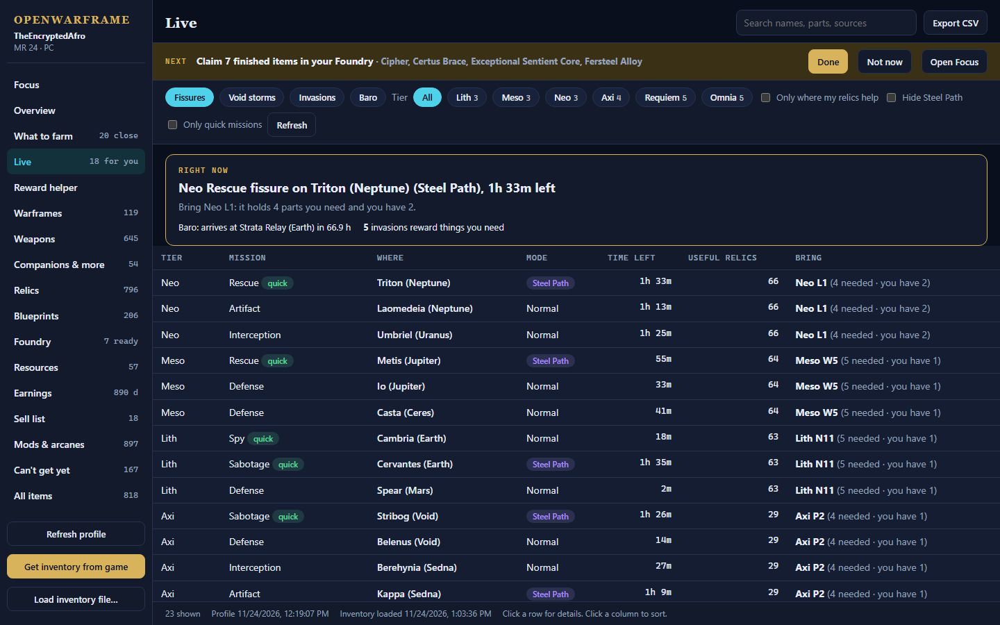
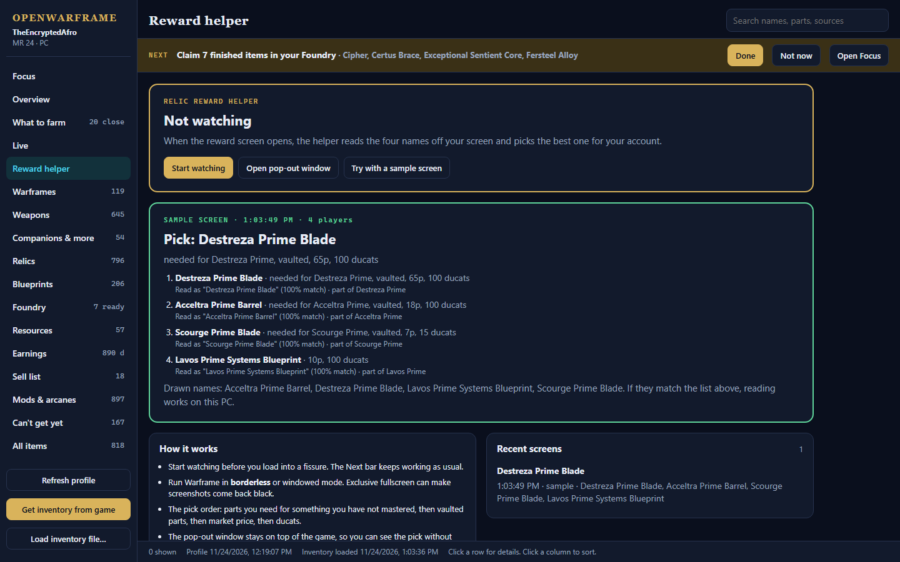
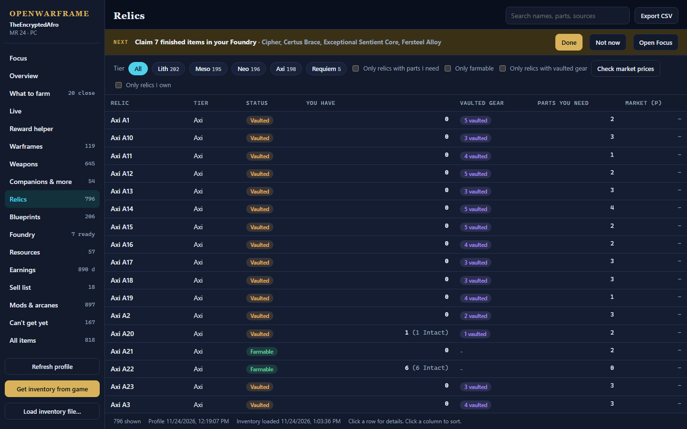
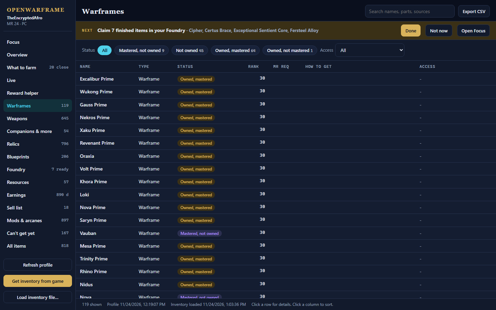
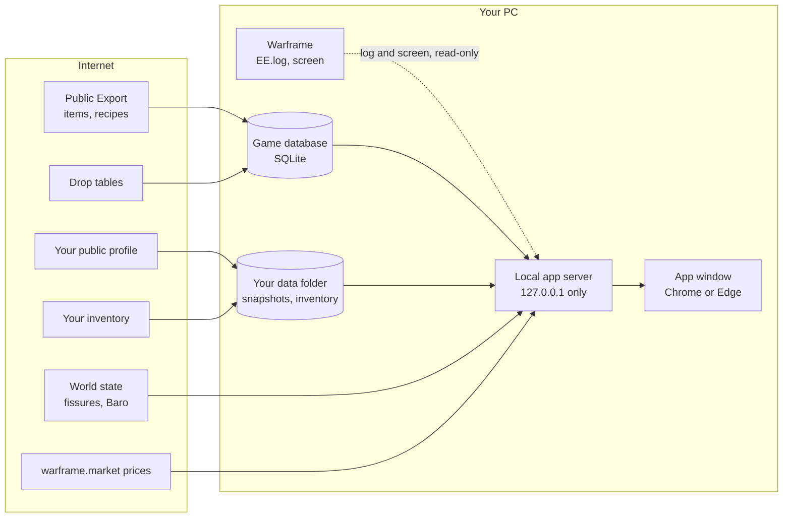

# OpenWarframe

**Your whole Warframe account in one window: what you own, what you're missing, and what to do next.**

OpenWarframe is a free, open-source Windows app that runs next to the game. It reads your account,
joins it with the game's own item and drop data and the live world state, and turns it into plain
answers: which relics to crack, which missions drop what you need, which reward to pick, and what
to do in the next 15 minutes on the road to Mastery Rank 30.


## Download

**[Download the latest release](https://github.com/AES256Afro/OpenWarframe/releases/latest)**
and get `OpenWarframe-<version>-windows.zip`. Unzip it and run `OpenWarframe.exe`. You don't need
Python, an installer or admin rights.

The app is not code-signed, so Windows SmartScreen asks you to click **More info**, then
**Run anyway**, the first time. Or install with one line in PowerShell (it also makes a desktop icon
and makes updates easy):

```powershell
irm https://raw.githubusercontent.com/AES256Afro/OpenWarframe/main/packaging/install.ps1 | iex
```

[docs/INSTALL.md](docs/INSTALL.md) covers both routes, checking the download's checksum and
antivirus false positives.

On first start the app downloads the game database (about a minute), then helps you connect your
account. With Warframe running, one click finds your account in the game. Or type your account ID.



## What it does

### Focus: one thing at a time

Built for players who get overwhelmed by Warframe's to-do pile, including people with ADHD or
autism. Focus shows **one next action** with where to go and why. It also has **Not now**
and **I'm tired, give me something easy** buttons. A session planner fits a short list into 15,
30, 60 or 90 minutes. You also get daily and weekly checklists that reset on the game's clock,
goals with progress bars, and comfort settings (larger text, higher contrast, no motion). A slim
**Next** bar keeps the current suggestion on every other tab.

### What to farm

Every mission node ranked by how many of the things *you* still need it drops. Each row shows the
best rotation and relic tiers, with popular community farms marked. **Finish an item** lists the
frames and weapons you are one or two parts away from, with each missing piece and what it costs
to buy instead.



### Live

The current void fissures, void storms, invasions and Baro Ki'Teer, matched against your
inventory. "Run the Neo Rescue on Triton and bring Neo L1: it holds 4 parts you need and you have
2." It also shows which mission you are in right now, read from the game's own log.



### Relic reward helper

When the fissure reward screen opens, OpenWarframe reads the four reward names off your screen
with Windows' built-in OCR. It then picks the best one for *your* account: parts you need first,
then vaulted parts, then market price, then ducats. A small pop-out window stays on top of the game,
so you can see the pick without alt-tabbing.




### Your whole collection

- **Warframes, Weapons, Companions & more:** every masterable item. Each shows whether it's mastered,
  leveling, never leveled or not owned, its MR requirement, how to get it, and whether you can get it now.
- **Relics:** every relic, with how many you own at each refinement, the parts you still need, how
  many rewards are vaulted, and live warframe.market prices.
- **Blueprints, Foundry, Resources:** what's ready to claim, what's missing for each build and the
  relics you own that drop it, and resource shortfalls.
- **Earnings and Sell list:** ducats and platinum you could make from spare parts, relics and mods,
  keeping one of anything you still need.
- **Can't get yet:** items gated by Mastery Rank, syndicate standing, vaulting or events.

Every table sorts by column, filters with chips and search, and exports to CSV.






### Exports and the Road to MR 30 guide

From the command line, `openwarframe export` writes your account as JSON, SQLite, CSV, a styled
Excel workbook, an account dashboard (HTML, PDF, Word) and an **LLM planning brief** for ChatGPT,
Claude or a local model. `openwarframe guide mastery --pdf --docx` builds a personal Road to MR 30
guide covering every remaining rank test, with "if you're tired, do this instead" fallbacks. Details:
[docs/EXPORTS.md](docs/EXPORTS.md).

## How it works



1. **Game database.** On first start, and whenever the app's code needs a newer format,
   OpenWarframe downloads Digital Extremes' official Public Export, the community
   [warframe-public-export-plus](https://github.com/calamity-inc/warframe-public-export-plus) data
   and the official drop tables. It joins them into one SQLite file on the game's internal item
   paths (for example `/Lotus/Powersuits/Rhino/RhinoPrime`).
2. **Your account** comes from two places:
   - The **public profile**: the same read-only endpoint the in-game profile viewer uses. It needs
     only your account ID and gives mastery rank, XP on every item you ever leveled, star chart
     progress, syndicates and intrinsics. **Refresh profile** fetches it again.
   - Your **inventory** (relics, blueprints, resources, the Foundry, mods, credits and platinum) is
     not public. With the game running, **Get inventory from game** reads the running game's
     memory, read-only, to find your session key. It downloads your inventory from Digital Extremes
     with that key, then discards the key. If you'd rather not, **Load inventory file** imports an
     inventory JSON from another tool.
3. **Live signals.** The official world state feed gives fissures, storms, invasions and Baro. The
   game's own `EE.log` tells the app which mission you're in and when the reward screen opens.
   The reward helper then captures the game window and reads it with Windows OCR, all on your PC.
4. **The app** is a small web server bound to `127.0.0.1`, so nothing else on your network can
   reach it. Its window is Chrome or Edge in app mode, with no tabs and no address bar. It stops by
   itself shortly after you close the window. Your data lives in `%LOCALAPPDATA%\OpenWarframe`.

## Privacy and risk, plainly

- **What leaves your PC:** requests to Digital Extremes (profile, inventory, world state, Public
  Export), GitHub and drops.warframestat.us (game data), and warframe.market (prices, only when you
  ask for them). There is no telemetry, no OpenWarframe account and no server of ours.
- **Reading game memory** happens only when you click **Get inventory from game**. It is read-only
  and opt-in, and the app shows this warning and asks once before the first use. Digital Extremes'
  EULA mentions software that reads the game's memory, and their policy is that third-party tools
  are used at your own risk. Other community tools work the same way, but nothing guarantees DE
  will keep tolerating it. Everything else in OpenWarframe works without it.
- **The reward helper** reads only the log file and screenshots of the game window. It never
  touches game memory or sends input. Screens it reads are saved in your data folder (`live`) so
  reading accuracy can be checked. Delete them whenever you like.
- OpenWarframe never stores your password, never injects into the game and never automates
  in-game actions.

Full detail on account data access: [docs/ACCOUNT_DATA_ACCESS.md](docs/ACCOUNT_DATA_ACCESS.md).

## Command line

The app covers day-to-day use. The CLI (`openwarframe`, or `openwarframe-cli.exe` in the zip) is
there for exports and scripting:

| Command | What it does |
| --- | --- |
| `gui` | Open the app (`--shortcut` adds a desktop icon) |
| `sync` | Fetch your public profile and store a snapshot |
| `inventory grab` / `import <file>` | Get your inventory from the running game, or from a file |
| `export` | JSON, SQLite, CSV, Excel, dashboard and LLM brief |
| `guide mastery` | Your Road to MR 30 guide (`--pdf`, `--docx`) |
| `codex update` / `sources "<item>"` / `tree "<item>"` | Game database: update it, where to get an item, what it needs |
| `live watch` / `live record` | Follow game events; save reward screens to check reading accuracy |
| `diff`, `snapshots`, `summary` | What changed between play sessions |

Run `openwarframe --help` for everything.

## Where the game data comes from

| Source | Gives us |
| --- | --- |
| Public Export (official) | Every weapon, frame, recipe with ingredients, resource, relic, mod, node, quest |
| [warframe-public-export-plus](https://github.com/calamity-inc/warframe-public-export-plus) (community, MIT) | Relic rewards, mission types, vendors, syndicates, challenges, Nightwave, bounties |
| Official drop tables via [WFCD warframe-drop-data](https://github.com/WFCD/warframe-drop-data) (MIT) | Mission, relic, enemy, bounty, sortie and syndicate drop chances |
| Official world state | Fissures, storms, invasions, Baro, sorties, Archon Hunt, Nightwave |
| [warframe.market](https://warframe.market) | Live prices for tradeable items |
| This repo's knowledge base (`kb/`) | Farming routes, popular relic farms, guides |

Details, URLs and licenses: [docs/DATA_SOURCES.md](docs/DATA_SOURCES.md). OpenWarframe is a fan
project and is not affiliated with or endorsed by Digital Extremes.

## Build from source

Needs [uv](https://docs.astral.sh/uv/).

```bash
uv sync --all-groups
```

```bash
uv run openwarframe gui
```

```bash
uv run pytest -q
```

The Windows zip is built by [.github/workflows/release.yml](.github/workflows/release.yml) with
PyInstaller ([packaging/openwarframe.spec](packaging/openwarframe.spec)) whenever a version tag is
pushed.

```
src/openwarframe/
  app/        desktop app: local server, page, farm ranking, live matching, reward helper
  codex/      game database build and queries
  account/    profile snapshots, diffs, summaries
  inventory/  inventory parsing
  sources/    Public Export, drop tables, market, profile, game session reader
  live/       EE.log follower, screen capture, OCR, reward matching
  guide/      Road to MR 30 guide (HTML, Word, PDF)
  exports/    JSON, SQLite, CSV, Excel, dashboard, LLM brief
  report/     account report used by the app and exports
kb/           curated knowledge base (routes, guides, popular farms)
docs/         install, architecture, data sources, roadmap, screenshots
tests/
```

## Contributing and license

MIT licensed; see [CONTRIBUTING.md](CONTRIBUTING.md). Third-party data keeps its own license and is
credited in [docs/DATA_SOURCES.md](docs/DATA_SOURCES.md). Plans and ideas live in
[docs/ROADMAP.md](docs/ROADMAP.md) and [docs/PLAN.md](docs/PLAN.md).
