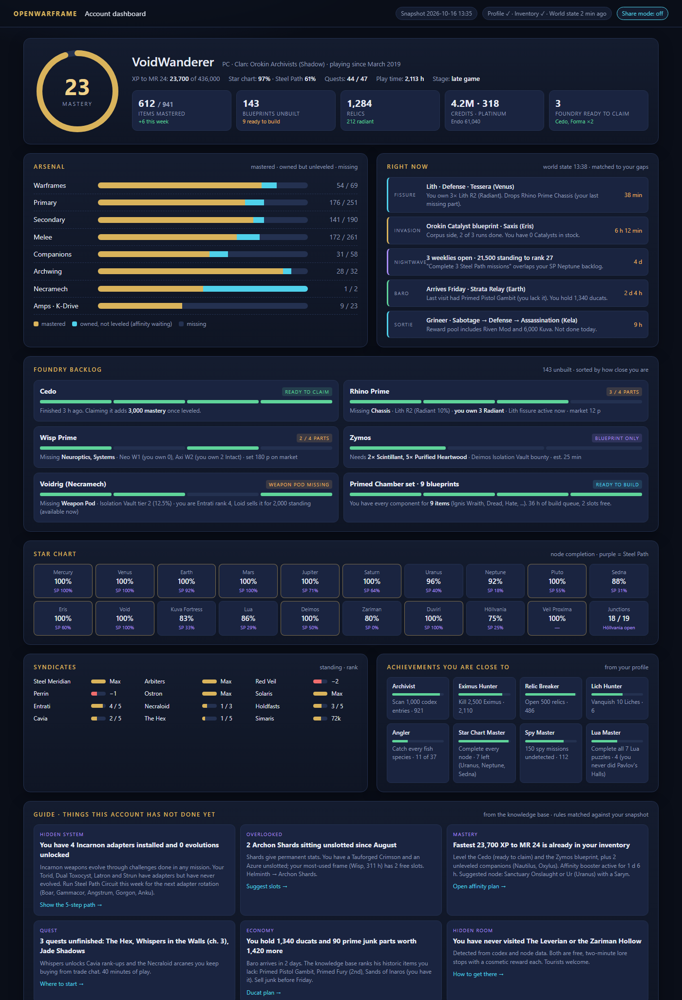
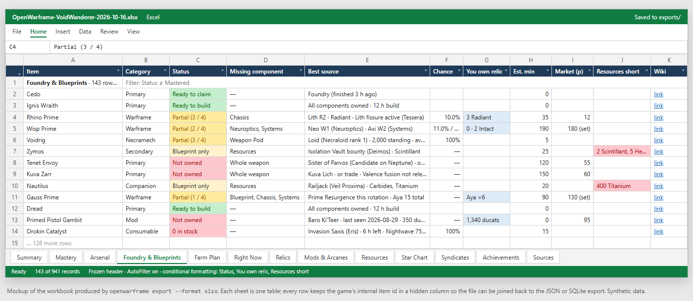
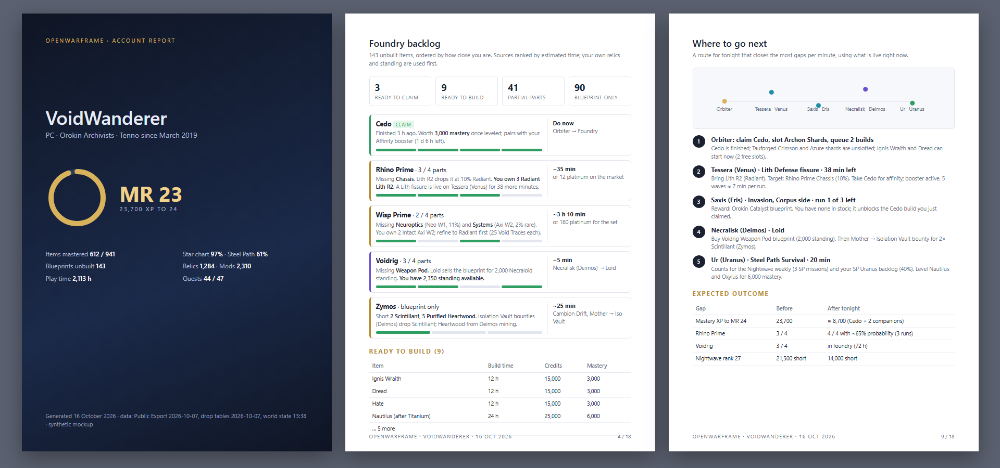
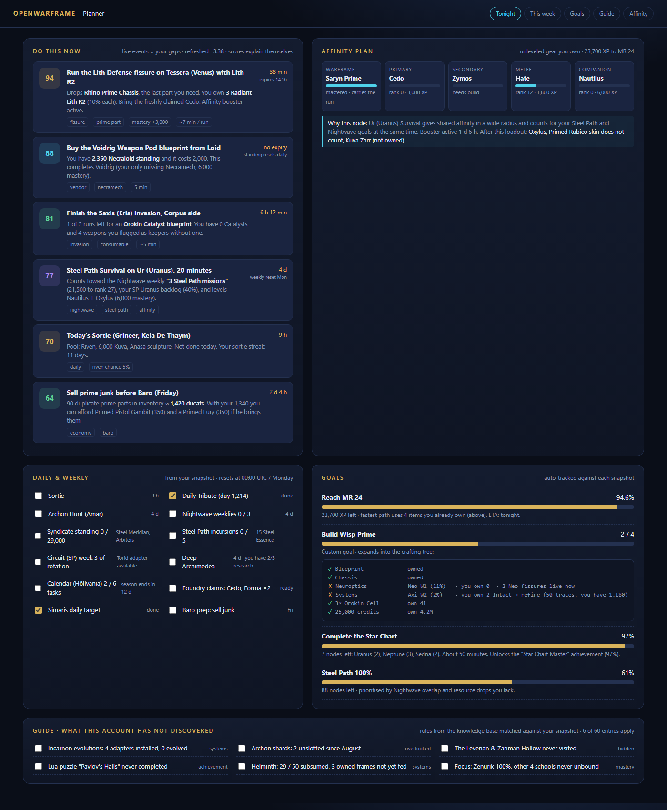
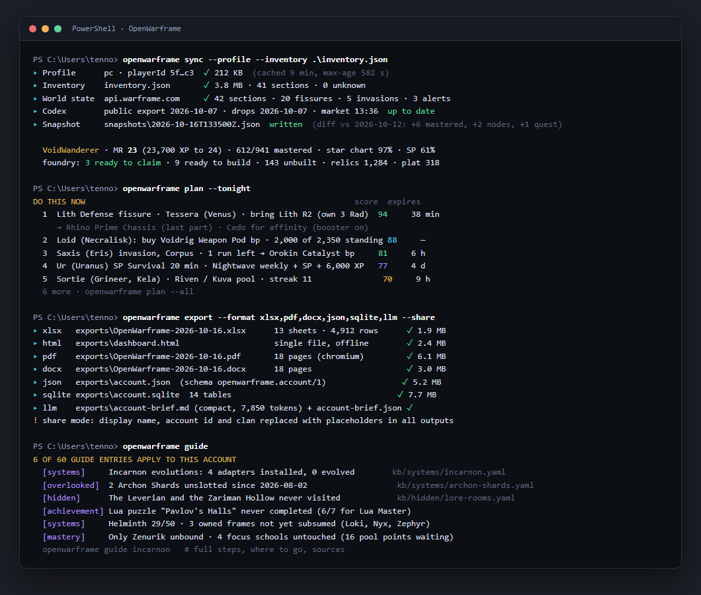

# Mockups

Static HTML mockups of the planned outputs. Open any `.html` file in a browser; they
have no external dependencies. All data is synthetic ("VoidWanderer" is not a real
account). Screenshots in `png/` are rendered from these files.

| # | Mockup | What it shows | Milestone |
| --- | --- | --- | --- |
| 01 | [Account dashboard](01-dashboard.html) | The single-file HTML dashboard: mastery ring, KPIs, arsenal bars, "Right now" events matched to gaps, foundry backlog cards, star chart strip, syndicates, achievements, guide cards | M5, M6, M7, M8 |
| 02 | [Excel workbook](02-excel-workbook.html) | The `Foundry & Blueprints` sheet with conditional formatting, and the full list of sheet tabs | M4 |
| 03 | [PDF report](03-pdf-report.html) | Cover page, foundry backlog page and a "Where to go next" route page, as printed from the dashboard | M5 |
| 04 | [Planner](04-planner.html) | Scored "do this now" recommendations with reasons, affinity loadout plan, daily/weekly checklist, goals with crafting trees, applicable guide entries | M7, M8 |
| 05 | [CLI](05-cli.html) | `sync`, `plan`, `export`, `guide` in a terminal | M2, M4, M7, M8 |

## Screenshots











## Visual identity (draft)

- Dark void background with a subtle blue radial glow; panels in deep navy.
- Orokin gold (`#d9b35b`) for headings and "mastered"; Tenno cyan (`#4fd1ea`) for
  "owned, not leveled" and live events; green for ready, amber for partial, violet for
  Steel Path and guide content.
- Every number that drives a recommendation is shown next to its reason and the
  timestamp of the data it came from.
- Print/PDF uses the same structure on white paper with the same accent colors.

Re-render the screenshots with Edge or Chrome in headless mode, for example:

```bash
"/c/Program Files (x86)/Microsoft/Edge/Application/msedge.exe" --headless=new --disable-gpu --hide-scrollbars --window-size=1400,2000 --screenshot=docs/mockups/png/01-dashboard.png "file:///$(pwd)/docs/mockups/01-dashboard.html"
```
